# Central governance architecture — revised requirements

One portal runs in the central security/tooling account. Its deployment stage is `central`. Governed account environments are `dev`, `testing` (displayed as Staging), and `production`. These environments do not create three copies of the tool. The original PDF is reference material; these revised requirements and the user's explicit dashboard-first choice govern this implementation.

```mermaid
flowchart LR
  SH[Security Hub findings / enabled AWS standards] --> Collect[Central collector Lambdas]
  Org[Organizations OUs and account tags] --> Collect
  Config[Config and deployment drift] --> Collect
  Collect --> DB[(Central evidence and change ledger)]
  DB --> UI[One central dashboard]
  UI --> Plan[Planner Lambda / immutable plan]
  Plan --> Gate{Environment and driver}
  Gate -->|Dev/Staging unmanaged native action| Run[Remediation Step Functions]
  Gate -->|Production or Terraform-managed| PR[ns-infrastructure-terraform PR]
  PR --> Check[Trusted-main plan workflow]
  Check --> Review{Production?}
  Review -->|Yes| Human[Authorized human review]
  Review -->|No mandatory review| Merge[Merge approved variable patch]
  Human --> Merge
  Merge --> Callback[IAM-only approval callback]
  Callback -->|Native/policy| Run
  Callback -->|Terraform| TF[Apply saved Terraform plan]
  Run --> Member[Assume bounded member write role]
  Member --> Verify[Read back AWS state]
  TF --> Recheck[Re-scan / source re-evaluation]
  Verify --> Recheck
  Recheck --> DB
```

## Evidence and standards

The collector ingests all Security Hub controls it receives, using ASFF `Compliance.SecurityControlId` and `Compliance.AssociatedStandards`. AWS standard ARNs are normalized to stable dashboard IDs. `DescribeStandards` supplies available framework names and editions; enabled status is specifically the central account's status. Finding associations establish member-account framework scope. AWS documents [consolidated findings](https://docs.aws.amazon.com/securityhub/latest/userguide/controls-findings-create-update.html) and [ASFF compliance fields](https://docs.aws.amazon.com/securityhub/latest/userguide/asff-top-level-attributes.html).

Enable Security Hub standards and Config recorders in the governed accounts/Regions first. Organization rollout needs a delegated administrator with cross-Region aggregation configured as appropriate. Regional standalone collection uses the pilot's own credentials. The app never invents a passing result when a service, subscription or permission is missing. The internal CIS/ISO catalog is a technical mapping, not certification or a replacement for AWS-reported standard associations.

## Action and approval policy

A finding event re-scans evidence; it never starts remediation. A scoped team owner or administrator must select current FAIL/WARN findings from the dashboard. Waived, unknown, closed and unclassified accounts are excluded. Mixed batches become separate requests per environment. Production OU membership overrides a lower-protection tag and is refreshed before application.

The planner derives desired state from a versioned runbook or a reviewed workspace binding, captures current state, then signs the immutable request with SHA-256. Plans expire after 24 hours. Before execution, the app verifies the plan, account scope and active exceptions again. Native execution compares the resource with the planned before state and refuses unexpected drift. Successful native execution reads the actual state back, then requests a scan. Terraform records apply results and requests a scan; Security Hub finding status remains source-reported until AWS re-evaluates it.

Production execution requires an exact-head, merged PR in the configured private monorepo, a successful `Terraform remediation plan` check, and a current human approval from a user with write/maintain/admin access (optionally narrowed by `remediation_approvers`). Bots and the PR author do not count. No dashboard endpoint can grant a real approval. AWS has a separate IAM-only validation Lambda for the plan identity and a callback Lambda for the apply identity.

Protect main, the workflow files, `governance/workspaces.yaml`, production account paths and `.governance/changes/production/` with CODEOWNERS. Use path-based rulesets if dev/staging should merge without review while production requires review. Require the plan check, dismiss stale approvals and prevent bypasses. GitHub documents the available [branch protection controls](https://docs.github.com/en/repositories/configuring-branches-and-merges-in-your-repository/managing-protected-branches/about-protected-branches). The server independently checks production review evidence even if branch rules were misconfigured.

## Remediation coverage

| Finding | Native runbook | Limit / Terraform route |
|---|---|---|
| S3.8 / S3_PUBLIC_ACCESS_BLOCKED | Enable all four account public-access block flags | Account-wide impact; map Terraform account settings when managed as code |
| S3.14 | Enable bucket versioning | Exact bucket ownership checked; refuses MFA Delete; tagged IaC ownership needs a workspace |
| EC2.7 | Enable default EBS encryption | Applies to newly created volumes, not existing unencrypted volumes |
| Other controls / drift | Explicit Terraform variable binding or manual action | No generic arbitrary Lambda, shell, or SDK execution |
| Root MFA / root credentials | Manual owner procedure | No simulated automatic fix in the demo |

`governance/remediations.yaml` is the versioned action catalog. Known IaC tags prevent native bucket changes; tags cannot discover every externally managed resource. Use the Terraform driver (default) for account settings or resources managed as code, and register their owning workspaces. AWS also describes the manual/automated remediation pattern and IaC considerations in its [automated security response solution](https://docs.aws.amazon.com/solutions/latest/automated-security-response-on-aws/solution-overview.html).

## Monorepo contract

Set `remediation_repository="YOUR-OWNER/ns-infrastructure-terraform"`. This code may live in that monorepo; when integrating an existing monorepo, install the two remediation workflows, `ci/terraform_remediation.py`, `app/functions/portal`, requirements and the reviewed `governance/workspaces.yaml` there. PRs modify only existing typed JSON variables plus one immutable request manifest. They never modify Terraform source, workflow files, IAM policy, or ownership bindings. Resource addresses must already exist in state; automatic import, create, delete, and replacement are rejected.

Workspaces conventionally live at `accounts/<dev|testing|production>/<account-id>/<region>`. Each uses an S3 backend with `use_lockfile=true`, a committed provider lock, and the AWS provider profile `governance-target` with `allowed_account_ids`. Backend credentials remain central OIDC credentials; the fixed profile resolves to a member read role at plan and a bounded member write role at apply. Plan files therefore contain the same profile name in both phases. The backend key is `<workspace-directory>.tfstate` in the central state bucket. Review existing workspace compatibility before enrollment.

The trusted-base workflow fetches and validates the PR data, overlays only server-approved variables onto protected source, and plans. It rejects Terraform changes outside the mapped resource addresses and any action other than update/no-op. All source content and the binary plan are hashed. After merge, a changed source tree, different artifact, expired plan or stale Terraform state causes failure; a read-only validation plan also compares current resource changes with the reviewed changes to detect intervening AWS drift. The workflow still applies only the original approved binary and rejects any difference. Native/policy PRs carry a manifest and use the same check/approval flow before Step Functions execution.

`examples/pilot-workspace` demonstrates existing-bucket versioning. Copy it to the chosen account path, set existing bucket/account values, configure local `governance-target` credentials for onboarding, initialize the exact central backend key, and import/adopt the existing versioning configuration. Establish a no-change baseline and commit its lock before adding its binding. Never create a new state for resources already owned by another workspace; bind that owning workspace instead. Start with a disposable test bucket. Do not suspend versioning on a production bucket to create a demonstration finding.

## Failure, drift, and exceptions

Step Functions invokes separate plan/apply/finalize Lambdas, with at most five concurrent native targets. Revision-checked ledger updates prevent lost outcomes. Resource leases serialize competing native changes. Each target records attempts and error messages; successful targets are skipped on native retry. A changed before state or OU requires a fresh request. Multi-account native operations and independent Terraform workspaces may partially succeed; there is no claim of an atomic cross-account transaction.

A Terraform failure is recorded per affected target/workspace. Fix IAM/backend/deployment prerequisites and create a fresh request/PR for failed targets. Terraform state locking and serial apply workflow concurrency protect state. Stale or failed changes are never blindly rolled back because rollback itself may be unsafe; the captured plan and actual current state inform a reviewed recovery change.

Production exception creation and revocation require their own PR. An exception is not effective while pending. Every exception has an owner, reason and expiry; production expiry is limited to 90 days. Expiry is re-evaluated during scans and every 15 minutes. Accepted risk is visible and excluded from the pass denominator. Fully waived or missing evidence never produces a healthy account.
